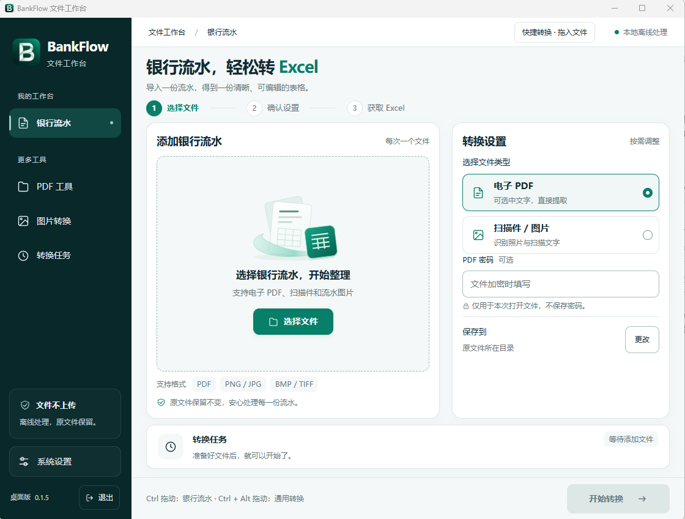
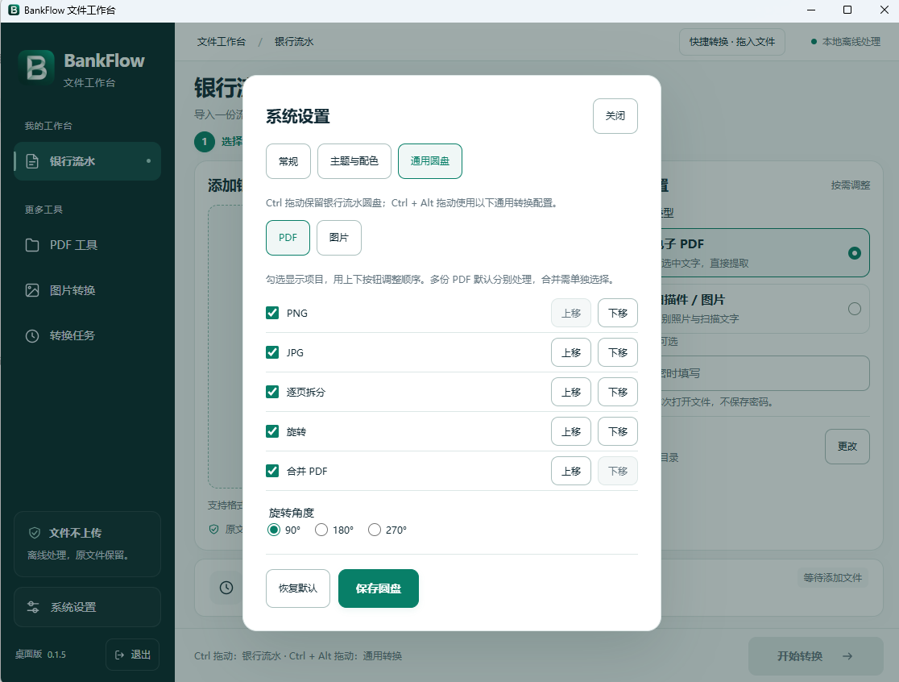
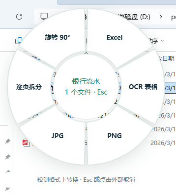

# BankFlow Next

BankFlow 是一款 Windows 本地文件工作台，可将电子银行流水、扫描件和流水图片转为 Excel，也可处理 PDF 和图片。流水解析、OCR 和 Excel 导出由 Rust 引擎在本机执行，文件保存在本机。

## 下载 1.0.1

在发布页的 **Assets** 中选择 Windows x64 安装包或免安装 ZIP。[下载 BankFlow Next 1.0.1](https://github.com/chenkewen/bankflow-next/releases/tag/v1.0.1)

| 版本 | 使用方式 |
| --- | --- |
| 安装版 | 运行以 `setup.exe` 结尾的安装包，按向导安装。系统缺少 WebView2 时，安装程序会联网获取。 |
| 免安装版 | 完整解压 ZIP，双击 `bankflow-workbench.exe`。移动程序时一起复制同目录的 `runtime` 文件夹，其中包含原生组件和 OCR 模型。目标电脑需已安装 WebView2。 |

## 流水转 Excel

1. 将一份 PDF 或流水图片拖到主窗口，或点击「选择文件」。
2. PDF 中的文字可以选中时，选「电子 PDF」。扫描版 PDF 或流水图片选「扫描件 / 图片」。
3. 点击「开始转换」。默认在原文件旁生成 Excel，也可在「保存到」更改目录。
4. 完成后可打开文件或目录。结果卡显示本次耗时，「查看日志」记录处理的文件及结果。点「清除本次」可清空当前选择、日志和任务记录，原件和已导出的 Excel 均保留。

Excel 将可确认且在精度范围内的金额保存为可求和的数值，账号和流水号以文本保留前导零。使用 OCR 时，请对照原件核对金额、余额和用于匹配的单号。难以确认的金额或部分账号、户名和流水号会以黄色底色和批注提示复核。

## PDF、图片与快捷圆盘

- **PDF 工具**支持合并、逐页拆分、提取页面、旋转及导出图片。
- **图片工具**支持缩放、转换为 PNG、JPG、WebP、BMP、TIFF，或将多张图片合并为 PDF。除了常见格式，也可读取 PSD/PSB 合成图、静态 AVIF、SGI、XBM、XPM、Sun Raster 等格式。
- **快捷圆盘**支持在资源管理器中按住 `Ctrl` 拖动文件打开银行流水圆盘，按住 `Ctrl + Alt` 拖动打开通用转换圆盘。将文件拖到目标操作上松手即可执行，按 `Esc` 取消。可在设置中调整通用圆盘项目、顺序和转换参数。

## 界面预览

### 文件工作台



### 通用圆盘设置



### 银行流水快捷圆盘



## 命令行转换

在程序所在目录打开 PowerShell，可指定单个文件或目录。`-o` 指定输出目录，`-r` 递归扫描子目录，`-p` 指定 PDF 密码。

```powershell
.\bankflow-workbench.exe --convert pdf .\流水.pdf -o .\结果
.\bankflow-workbench.exe --convert ocr .\扫描件 -r -o .\结果
```

指定单个文件时，成功后会替换输出目录中的同名 Excel。处理目录时，重名结果会自动追加 ` (1)`、` (2)` 等序号。成功返回 `0`，转换失败返回 `1`，参数错误返回 `2`。

## 从源码开发

桌面端使用 Tauri 和 Rust，界面使用 TypeScript。首次构建请先准备 Windows x64 开发环境和原生运行资源。[开发环境准备](scripts/README.md)

```powershell
npm ci
npm run desktop
```

| 命令 | 用途 |
| --- | --- |
| `npm run desktop:portable` | 构建免安装版，产物位于 `build/portable/`。 |
| `npm run desktop:build` | 构建 Windows 安装包，产物位于 `src-tauri/target/release/bundle/nsis/`。 |
| `npm test` | 运行 Rust 单元测试、转换回归和浏览器界面测试。界面测试需要 Microsoft Edge。 |
| `npm run test:desktop` | 在独立的 Tauri/WebView2 窗口中验证桌面任务和设置。 |
| `npm run test:portable` | 在构建免安装版后，验证发布版的界面、转换和清除本次操作。 |

主要源码位于 `frontend/` 和 `src-tauri/src/`。构建资源准备脚本位于 `scripts/`，回归测试位于 `verification/`。
